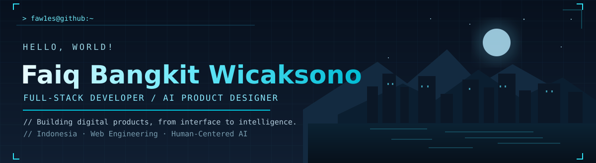

<div align="center">
  
<br />

<br />

  <a href="https://github.com/faw1es?tab=followers"></a>
</div>
---
<table>
<tr>
<td width="58%" valign="top">
`01 / about-me`
Hi! I'm Faiq Bangkit Wicaksono, a Full-Stack Developer & AI Product Designer based in Indonesia.
I build modern web applications and human-centered AI product experiences, connecting thoughtful interfaces with practical backend systems.
🏆 Machine Learning competition winner — 2024
⚙️ Frontend, backend, REST APIs & automation
🧠 Interested in ML, Generative AI & intelligent systems
🌱 Exploring .NET, system design & AI integration
</td>
<td width="42%" valign="top">
`02 / currently`
```text
> Building modern web applications
> Exploring .NET and system design
> Designing useful AI experiences
> Improving automation workflows
```
Principle
> Technology should solve meaningful problems and create better experiences for people.
</td>
</tr>
</table>
`03 / tech-stack`
<div align="center">
FRONTEND DEVELOPMENT


BACKEND & AI


DESIGN, TOOLS & WORKFLOW

</div>
---
`04 / what-i-do`
<table>
<tr>
<td width="33%" valign="top">
🌐 Full-Stack Development
Responsive interfaces, REST APIs, frontend–backend integrations, authentication, role-based access, and maintainable systems.
</td>
<td width="34%" valign="top">
🤖 AI Product Design
Human-centered AI concepts, product prototypes, machine learning exploration, and Generative AI integration.
</td>
<td width="33%" valign="top">
⚙️ Automation
PowerShell scripting, repeatable developer workflows, GitHub Actions, and CI/CD processes.
</td>
</tr>
</table>
`05 / selected-work`
<div align="center">
Projects worth exploring
I work on web applications, data-driven systems, and AI product ideas. Browse my public repositories for current code and projects.
<a href="https://github.com/faw1es?tab=repositories"></a>
</div>
<!-- Replace this section with 2–3 real pinned project cards once you choose which repositories to feature. -->
---
`06 / github-analytics`
<div align="center">
  
  <br />
  
  
  <br /><br />
  
</div>
`07 / contribution-activity`
<div align="center">
  
</div>
---
`08 / connect`
<div align="center">
  <a href="https://github.com/faw1es"></a>
  <a href="https://www.linkedin.com/in/faiq-bangkit-wicaksono-36b07022b/"></a>
  <a href="mailto:faiqbw12@gmail.com"></a>


<sub>BUILD · LEARN · IMPROVE · REPEAT</sub>
<br />
Building complete digital products — from interface to intelligence.
</div>
